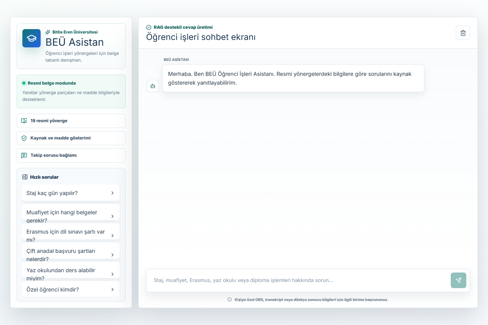
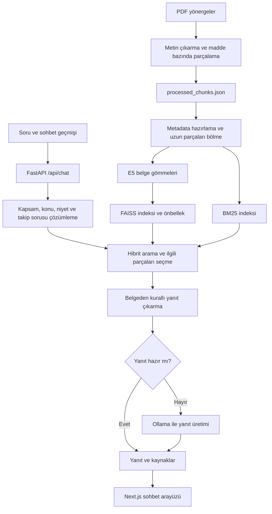

# BEÜ Öğrenci İşleri Chatbot

**Bitlis Eren Üniversitesi öğrenci işleri yönergelerini Türkçe sorularla sorgulamayı sağlayan, kaynak ve madde gösteren bir RAG uygulaması.**

Öğrencilerin staj, Erasmus, çift anadal, muafiyet, yaz okulu ve benzeri konularda uzun PDF belgeleri içinde arama yapmak yerine sorularını sohbet arayüzünden sormasını amaçlar. Sistem soruyla ilgili yönerge parçalarını bulur, belgeye dayalı yanıt üretir ve kullanılan kaynakları gösterir.

Bu depo bir öğrenci projesidir; üniversitenin resmi danışmanlık hizmeti olarak sunulmaz. Yanıtların kapsamı ve güncelliği yüklenen belgelerle sınırlıdır.

## Arayüz önizlemesi

Projede bulunan masaüstü ekran görüntüsü:



## İçindekiler

- [Özellikler](#özellikler)
- [Örnek sorular](#örnek-sorular)
- [Teknolojiler](#teknolojiler)
- [Sistem mimarisi](#sistem-mimarisi)
- [Proje yapısı](#proje-yapısı)
- [Kurulum ve çalıştırma](#kurulum-ve-çalıştırma)
- [API kullanımı](#api-kullanımı)
- [Belge ekleme ve veri hazırlama](#belge-ekleme-ve-veri-hazırlama)
- [Kontroller ve testler](#kontroller-ve-testler)
- [Bilinen sınırlamalar](#bilinen-sınırlamalar)
- [Katkı ve lisans](#katkı-ve-lisans)

## Özellikler

- **Türkçe soru-cevap:** Öğrenci işleri süreçlerini doğal dilde sorgulama.
- **Madde bazında parçalama:** PDF metnini `MADDE` numaralarına göre ayırıp kaynak bilgisiyle saklama.
- **Hibrit arama:** E5 çok dilli gömmeleri ve FAISS ile anlamsal aramayı, BM25 anahtar kelime aramasıyla birleştirme.
- **Konu ve niyet kuralları:** Tanım, başvuru koşulu ve gerekli belgeler gibi soru türlerini ayırt ederek ilgili içeriği seçme.
- **Kaynak gösterimi:** Yanıtla birlikte yönerge adı ve madde numarası döndürme.
- **Takip soruları:** İstemcinin gönderdiği yakın sohbet geçmişiyle kısa soruları bağlama oturtma.
- **Kapsam kontrolü:** Kapsam dışı veya doğrudan belge desteği bulunamayan sorularda yönlendirme yanıtı verme.
- **Yerel dil modeli:** Gerektiğinde Ollama üzerinden `llama3.2:3b` ile yanıt üretme; bağlantı hatalarında belge parçalarına dayalı yedek yanıt oluşturma.
- **İndeks önbelleği:** FAISS indeksini diskte saklama ve veri özeti eşleştiğinde tekrar kullanma.
- **Web arayüzü:** Açık/koyu tema, hazır soru önerileri, Markdown yanıtları ve mobil uyumlu sohbet ekranı.

Mevcut veri kümesi **19 PDF yönerge** ve `data/processed_chunks.json` içinde **302 başlangıç metin parçası** içerir. Servis uzun parçaları başlatma sırasında yeniden bölebildiği için indekslenen parça sayısı farklı olabilir. Bu sayılar doğruluk ölçümü değildir.

## Örnek sorular

| Konu | Soru |
| --- | --- |
| Staj | Staj kaç gün yapılır? |
| Muafiyet | Muafiyet için hangi belgeler gerekir? |
| Erasmus | Erasmus için dil sınavı şartı var mı? |
| Çift anadal | Çift anadal başvuru şartları nelerdir? |
| Yaz okulu | Yaz okulundan ders alabilir miyim? |
| Özel öğrencilik | Özel öğrenci kimdir? |
| Takip sorusu | Şartları nedir, madde madde anlat. |

Takip soruları önceki konuşma geçmişiyle birlikte değerlendirilir. Yanıtlar ilgili bilginin belgelerde bulunmasına bağlıdır.

## Teknolojiler

| Katman | Teknoloji | Görevi |
| --- | --- | --- |
| API | Python, FastAPI, Pydantic, Uvicorn | İstek doğrulama ve sohbet uç noktaları |
| PDF işleme | pdfplumber, düzenli ifadeler | Metin çıkarma ve madde bazında parçalama |
| Metin gömme | Sentence Transformers, `intfloat/multilingual-e5-base` | Soru ve belge vektörleri |
| Arama | FAISS, BM25, NumPy | Anlamsal ve sözcüksel erişim |
| Yanıt üretimi | Ollama, `llama3.2:3b`, Requests | Yerel LLM çağrıları |
| Güncel arayüz | Next.js 16.2.6, React 19.2.4, TypeScript | Sohbet uygulaması |
| Görünüm | Tailwind CSS 4, Framer Motion, Lucide, React Markdown | Tema, animasyonlar ve yanıt biçimlendirme |
| Alternatif veri hattı | SQLite, Pydantic fiş modelleri | Ayrıntılı yönerge fişlerinin saklanması |

LangChain paketleri bağımlılık listesinde bulunur; güncel `RAGService` arama ve Ollama çağrılarını doğrudan gerçekleştirir.

## Sistem mimarisi



Her soru için dil modeli çağrılmaz. Servis önce ilgili fişlerden yanıt çıkarmayı dener; yeterli olmadığında Ollama kullanır. Güncel V2 API tamamlanmış yanıtı JSON olarak döndürür.

## Proje yapısı

```text
ogrenci_isleri_chatbot/
├── README.md
├── requirements.txt
├── data/
│   ├── raw_pdf/                  # Kaynak PDF yönergeler
│   └── processed_chunks.json     # Güncel V2 servisinin başlangıç verisi
├── frontend_v2/
│   ├── src/app/page.tsx          # Sohbet ekranı ve API çağrıları
│   ├── src/app/globals.css       # Tema ve arayüz stilleri
│   └── package.json
├── src/
│   ├── api/v2_server.py          # Güncel JSON API
│   ├── services/rag_service.py   # Arama, bağlam, yanıt ve kaynaklar
│   ├── utils/processor.py        # V2 PDF → JSON hazırlama
│   ├── config.py                # Model, yollar ve zaman aşımı ayarları
│   ├── pipeline/                # Alternatif temizleme ve ayrıştırma
│   ├── fiche/                   # Fiş modelleri ve oluşturucu
│   ├── database/                # SQLite işlemleri
│   ├── embeddings/              # Alternatif SQLite → FAISS hattı
│   ├── rag/                     # Önceki sürüm erişim ve istem kodu
│   └── test_rag_guardrails.py    # Kapsam ve takip sorusu kontrolleri
└── docs/GITHUB_YAYINLAMA.md      # Depo açıklaması ve yayın kapsamı
```

Ana kullanım yolu **`frontend_v2` + `src.api.v2_server`** ikilisidir. `src/api/server.py`, `run_chatbot.bat` ve `run_all.py` önceki akışlara aittir. Eski `frontend/` klasörü ayrı bir Git geçmişi içerdiğinden bu yayın kapsamına alınmaz; bilgisayardaki dosyaları korunur.

## Kurulum ve çalıştırma

### 1. Gereksinimler

- Python 3.10 veya üzeri; bu çalışma alanında Python 3.10 kullanılır.
- Next.js 16 ile uyumlu Node.js; en az 20.9 sürümü.
- npm ve Git.
- LLM yanıtları için Ollama ve indirilmiş `llama3.2:3b` modeli.
- İlk kurulumda paketler ve E5 modeli için internet erişimi.

İlk açılışta E5 modelinin indirilmesi ve indeksin hazırlanması zaman alabilir. Süre donanım ve bağlantıya bağlıdır.

### 2. Depoyu indir

```powershell
git clone https://github.com/zeynebyy/ogrenci_isleri_chatbot.git
cd ogrenci_isleri_chatbot
```

### 3. Python ortamını hazırla

Proje kökünde:

```powershell
python -m venv .venv
.\.venv\Scripts\python.exe -m pip install --upgrade pip
.\.venv\Scripts\python.exe -m pip install -r requirements.txt
```

Komutlar sanal ortamı etkinleştirmeden çalışır. Linux/macOS üzerinde Python yolu `.venv/bin/python` olur.

### 4. Ollama modelini hazırla

```powershell
ollama pull llama3.2:3b
ollama serve
```

Ollama arka planda çalışıyorsa ikinci bir sunucu başlatmak gerekmez. Varsayılan üretim adresi `http://localhost:11434/api/generate` olarak ayarlıdır.

### 5. API'yi başlat

Depodaki `data/processed_chunks.json` hazır veri olarak kullanılabilir. Proje kökünde yeni bir terminal aç:

```powershell
.\.venv\Scripts\python.exe -m uvicorn src.api.v2_server:app --host 127.0.0.1 --port 8002
```

- Durum bilgisi: `http://127.0.0.1:8002/health`
- Etkileşimli API dokümantasyonu: `http://127.0.0.1:8002/docs`

**Port önemlidir:** Arayüz `http://127.0.0.1:8002/api/chat` adresini kullanır. `v2_server.py` doğrudan çalıştırıldığında 8001 portunu seçer; yukarıdaki Uvicorn komutu arayüzle eşleşen 8002 portunu belirtir.

`/health` sürecin çalıştığını ve model adını gösterir; arama indeksinin hazır olduğunu tek başına doğrulamaz. Başlangıç günlüklerini ve bir sohbet isteğini de kontrol et.

### 6. Arayüzü başlat

Başka bir terminalde:

```powershell
cd frontend_v2
npm ci
npm run dev
```

Tarayıcıda `http://localhost:3000` adresini aç. Python API'si ve Ollama arayüzle birlikte çalışmalıdır.

### Yapılandırma

| Ayar | Dosya | Varsayılan |
| --- | --- | --- |
| Dil modeli | `src/config.py` → `DEFAULT_MODEL` | `llama3.2:3b` |
| Ollama adresi | `src/config.py` → `OLLAMA_URL` | `http://localhost:11434/api/generate` |
| LLM zaman aşımı | `src/config.py` → `LLM_TIMEOUT` | 300 saniye |
| Arayüz API adresi | `frontend_v2/src/app/page.tsx` → `API_URL` | `http://127.0.0.1:8002/api/chat` |
| Gömme modeli | `src/services/rag_service.py` | `intfloat/multilingual-e5-base` |

Mevcut kod bu ayarları `.env` dosyasından okumaz. Adres veya model değişikliği için sabitleri düzenleyip süreçleri yeniden başlat.

## API kullanımı

### `GET /health`

```json
{"status": "ok", "model": "llama3.2:3b"}
```

### `POST /api/chat`

İstek gövdesi:

```json
{
  "message": "Çift anadal için gerekli belgeler nelerdir?",
  "history": [
    {"role": "user", "content": "Çift anadal nedir?"},
    {"role": "assistant", "content": "Önceki asistan yanıtı"}
  ]
}
```

`history` isteğe bağlıdır. API son sekiz geçmiş girdisini servise aktarır; servis konuşma durumunu hesaplarken son beş girdiyi değerlendirir. Sohbet geçmişi istemciden gönderilir, kalıcı bir sohbet veritabanında tutulmaz.

| Yanıt alanı | Açıklama |
| --- | --- |
| `answer` | Kullanıcıya gösterilecek yanıt |
| `sources` | `source`, `madde` ve `title` içeren kaynak listesi |
| `error` | Normal yanıtta `null`; bazı hata yollarında hata etiketi |
| `conversation_state` | Servis yanıtlarında konu, niyet ve varsa genişletilmiş soru bilgisi |

PowerShell ile örnek istek:

```powershell
$chatBody = @{ message = "Özel öğrenci kimdir?"; history = @() } | ConvertTo-Json
Invoke-RestMethod -Uri "http://127.0.0.1:8002/api/chat" -Method Post -ContentType "application/json; charset=utf-8" -Body ([System.Text.Encoding]::UTF8.GetBytes($chatBody))
```

Boş veya yalnızca boşluk içeren `message` HTTP 400 döndürür. Kapsam dışı sorular yönlendirme yanıtı alabilir. Beklenmeyen sohbet hatalarında API HTTP 200 ile `error: "server_error"` döndürebildiğinden istemciler `error` alanını da değerlendirmelidir.

## Belge ekleme ve veri hazırlama

1. Metin içeren PDF yönergeleri `data/raw_pdf/` klasörüne ekle.
2. Proje kökünde aşağıdaki komutu çalıştır:

```powershell
.\.venv\Scripts\python.exe -m src.utils.processor
```

3. Oluşan `data/processed_chunks.json` dosyasını incele. Parçalar `content` ve `metadata`; metadata ise kaynak, başlık, madde ve tür alanlarını içerir.
4. API'yi yeniden başlat. Servis BM25 indeksini hazırlar ve veri özeti değiştiyse FAISS indeksini yeniden oluşturur.

İşlem `processed_chunks.json` dosyasını mevcut PDF kümesinden yeniden yazar. Elle düzeltilmiş veri kullanıyorsan önce değişikliklerini kaydet. Yeni yönerge türlerinde konu kurallarını da uyarlamak gerekebilir.

Metin çıkarma için pdfplumber kullanılır. Yalnızca görüntü içeren taranmış PDF'ler için ayrıca OCR gerekir; mevcut hatta OCR bulunmaz.

### Alternatif SQLite fişleme hattı

```powershell
.\.venv\Scripts\python.exe -m src.main
.\.venv\Scripts\python.exe -m src.create_database
.\.venv\Scripts\python.exe -m src.embeddings.embed_fiches
```

Bu hat sırasıyla `data/fiches/fiches.json`, `data/database/chatbot.db`, `data/vector_index.faiss` ve `data/vector_meta.json` üretir. Güncel V2 API'nin veri akışından ayrıdır; V2 kurulumunda çalıştırılması gerekmez.

## Kontroller ve testler

Güncel RAG davranış kontrolleri:

```powershell
.\.venv\Scripts\python.exe -m src.test_rag_guardrails
```

Kontroller; tanım ile başvuru şartlarının karışmaması, gerekli belgeler, kaynak maddeleri, takip sorusu bağlamı, konu değişimi ve kapsam dışı soruları kapsar. Gerçek veri kümesini ve E5 modelini kullanır; bazı yanıt yolları Ollama'ya başvurabilir.

Arayüz kontrolleri:

```powershell
cd frontend_v2
npm run lint
npm run build
```

`next/font/google` nedeniyle derleme sırasında Google Fonts erişimi gerekebilir. Diğer `src/test_*.py` betiklerinin bir bölümü eski veri ve indeksleri bekler; hepsi tek bir güncel test paketi olarak değerlendirilmemelidir.

26 Ekim 2026 tarihli yayın hazırlığında üretim derlemesi ve RAG davranış kontrolleri başarılı oldu. ESLint, `frontend_v2/src/app/page.tsx` içindeki başlangıç tema efektinde mevcut `react-hooks/set-state-in-effect` hatasını bildirdi; lint kontrolü henüz başarılı değildir. Ayrıntılar [doğrulama notlarında](docs/GITHUB_YAYINLAMA.md#yayın-öncesi-doğrulama) yer alır.

## Bilinen sınırlamalar

- Sistem canlı yönerge veya güncel duyuru çekmez. Belgeler yenilenmedikçe yanıtlar güncelliğini kaybedebilir.
- Kaynak gösterimi tek başına doğruluk garantisi vermez; başvuru, tarih ve koşullar ilgili resmi belgeyle doğrulanmalıdır.
- Güncel V2 API akışlı yanıt vermez; önceki API'deki `/chat/stream` ayrı bir uygulama yoludur.
- API geliştirme yapılandırmasındadır: CORS tüm kökenlere açıktır; kimlik doğrulama ve istek hız sınırı uygulanmaz.
- Arayüzdeki `127.0.0.1`, tarayıcının çalıştığı cihazı ifade eder. Uzak sunucu veya telefon kullanımında API adresi ve ağ ayarları uyarlanmalıdır.
- Model gecikmesi donanıma bağlıdır. İndeks önbelleği model yükleme gereksinimini ortadan kaldırmaz.
- Python bağımlılık sürümleri sabitlenmemiştir; farklı kurulumlarda sürüm uyumluluğu kontrol edilmelidir.

## Katkı ve lisans

Hata bildirirken örnek soruyu, beklenen davranışı, dönen yanıtı ve ilgili yönergeyi belirt. Belge güncellemelerinden sonra davranış kontrollerinin tekrar çalıştırılması önerilir.

Depoya henüz yazılım lisansı eklenmemiştir. Açık kaynak lisansı seçilmeden kullanım ve yeniden dağıtım izni varsayılmamalıdır. PDF yönergelerinin hakları ilgili kurumlara aittir; yazılım için seçilecek lisans bu belgelere otomatik olarak uygulanmaz.

GitHub depo açıklaması ve yayın kapsamı için [yayınlama notlarına](docs/GITHUB_YAYINLAMA.md) bakabilirsin.
